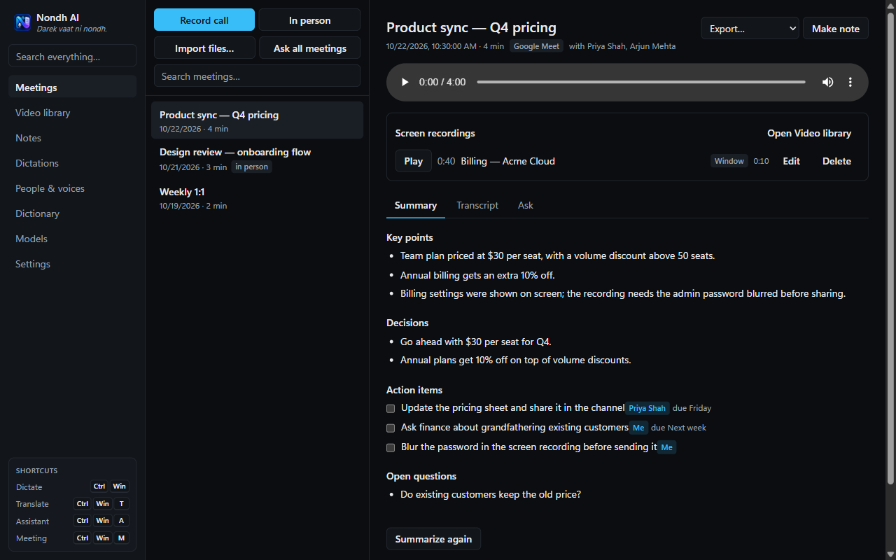
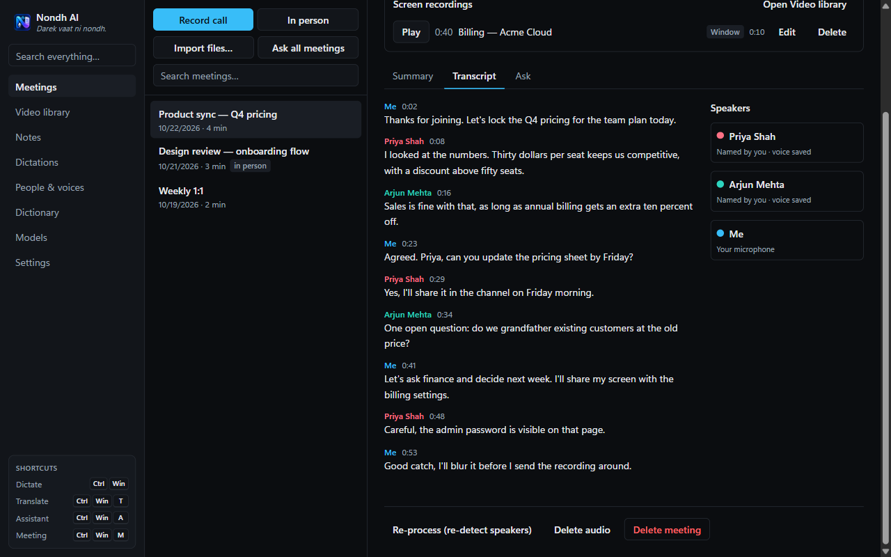
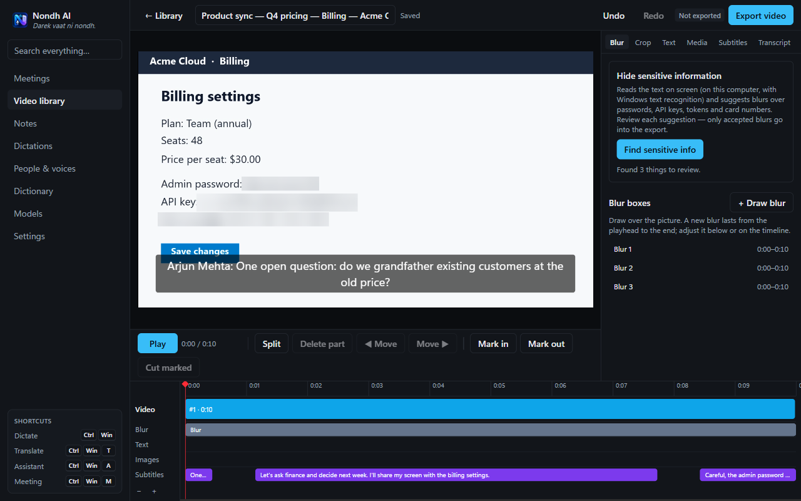

# Nondh AI

*Darek vaat ni nondh.* — "A note of every conversation."


Offline-first dictation and meeting transcription for Windows. Third-party notices: `THIRD_PARTY_NOTICES.md`.

- **Dictation**: hold `Ctrl+Win`, speak, release. Clean text is pasted into the focused app, and your clipboard is put back afterwards. Double-tap to lock recording on. `Ctrl+Win+T` translates; `Ctrl+Win+A` is the assistant (edits selected text, or answers).
- **Meetings**: `Ctrl+Win+M`, the tray, or the "call detected" prompt. Your mic and the call audio are recorded as separate tracks, with echo removal, a live transcript, then speaker separation, voice memory, a summary, Q&A and exports.
- **Screen recording**: during a meeting, record the entire screen, one window, or a region, as many times as you like. A visible badge shows while it records.
- **Video library**: edit those recordings. Cut, split, reorder, crop, blur, add text, images and music, and burn in subtitles made from the transcript. "Find sensitive info" reads the screen with Windows OCR on this computer and suggests blurs over passwords, API keys, tokens and card numbers for you to review. Several recordings from the same meeting can be merged into one video after you confirm. You can also **import videos** (MP4, MOV, WebM, MKV, AVI, WMV, phone videos…; drag and drop works), edit and merge them the same way, and make subtitles from their speech with the offline model. Exports are MP4 files; your originals are never changed.
- **Notes and search**: rich-text notes in folders, keyword + semantic search, AI actions.
- **Integrations**: local API and MCP server (`docs/API.md`), Google/Microsoft calendar (`docs/CALENDAR.md`).

Everything runs locally by default (Parakeet / Whisper / Qwen via llama.cpp). Cloud providers are optional, use your own keys, and are marked "cloud" wherever they're used.

## Screenshots

**Meeting summary**: key points, decisions, action items with owners, and open questions, made after the call.



**Transcript with speakers**: who said what and when, with names remembered by voice.



**Video editor**: "Find sensitive info" spotted the password, API key and card number in a screen recording and blurred them.



## Download

**[Download the latest version](https://github.com/Hemang67/NondhAI/releases/latest)**: get `NondhAI-Setup-<version>.exe` and run it (Windows 10/11, 64-bit). Every earlier version is on the [Releases page](https://github.com/Hemang67/NondhAI/releases).

The installer isn't code-signed yet, so Windows may say "Windows protected your PC". Click **More info → Run anyway**. Installing a newer version over an older one keeps your meetings, notes and settings.

## Develop

```
npm install
npm run build:native   # needs VS 2022 Build Tools (C++)
npm run dev            # in shells inherited from VS Code: unset ELECTRON_RUN_AS_NODE first
npm test
npm run dist           # → release/NondhAI-Setup-x.y.z.exe
npm run release        # bump "version" and commit first: builds, tags vX.Y.Z, publishes a GitHub Release with the installer
```

Bundled binaries live in `resources/bin` (git-ignored): `llama/` (llama.cpp Vulkan build), `whisper/Release/` (whisper.cpp), plus `vd-input.exe` and `vd-audio.exe` built from `native/`. Models download from the app's Models page into the models folder you choose.

Design: `docs/PLAN.md`. Evidence per phase: `docs/evidence/`.

## License

[MIT](LICENSE) © 2026 Hemang Rathod. Third-party notices: [THIRD_PARTY_NOTICES.md](THIRD_PARTY_NOTICES.md).
